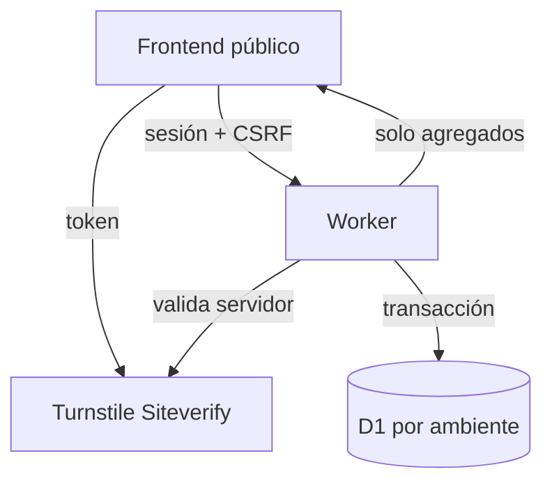

# Diseño futuro de participación real

**Estado:** diseño técnico listo para revisión; implementación y tratamiento de datos bloqueados.  
**Issue:** #22.  
**Decisión por defecto:** mantener `/api/votes` cerrado.

## 1. Propósito y límites

El objetivo futuro sería medir apoyos voluntarios dentro de una edición local, como encuesta ciudadana no representativa. No es un sistema electoral, no verifica identidad civil, no certifica una persona/un voto y no debe presentarse como resultado oficial o pronóstico.

Seleccionar una candidatura puede revelar una opinión política, categoría especialmente protegida por el artículo 9 RGPD. Un HMAC o identificador opaco reduce exposición, pero sigue siendo seudonimización si permite singularizar o volver a atribuir información. Por ello este documento no elige una base jurídica ni sustituye una EIPD o asesoramiento jurídico.

## 2. Arquitectura propuesta



### Componentes y responsabilidades

| Componente | Responsabilidad | No debe hacer |
| --- | --- | --- |
| Frontend | explicar límites, pedir sesión, completar Turnstile y enviar una selección | decidir validez, guardar preferencia o secretos |
| Worker | validar método, origen, CSRF, Turnstile, ventana, esquema, abuso y transacción | aceptar `X-Forwarded-For`, registrar cuerpo/IP o confiar en el widget |
| D1 | guardas anti-duplicado, totales agregados, edición y auditoría administrativa separada | guardar IP cruda o vincular guarda con candidatura |
| Administración futura | abrir/cerrar edición y revisar agregados con autorización | compartir credenciales o editar producción desde preview |

## 3. Modelo de datos minimizado

No reutilizar directamente la tabla `votes` inicial, porque vincula `candidate_id` con `ip_hmac` y `device_hmac`. Antes de implementar se requiere una migración nueva, nunca una edición retroactiva de `0001_initial.sql`.

```sql
CREATE TABLE participation_guards (
  edition_id TEXT NOT NULL,
  guard_kind TEXT NOT NULL CHECK (guard_kind IN ('network','browser')),
  guard_hmac TEXT NOT NULL,
  expires_at TEXT NOT NULL,
  PRIMARY KEY (edition_id, guard_kind, guard_hmac)
);

CREATE TABLE support_totals (
  edition_id TEXT NOT NULL,
  candidate_id TEXT NOT NULL,
  support_count INTEGER NOT NULL DEFAULT 0 CHECK (support_count >= 0),
  PRIMARY KEY (edition_id, candidate_id),
  FOREIGN KEY (edition_id, candidate_id) REFERENCES edition_candidates(edition_id, candidate_id)
);
```

El ejemplo presupone una tabla normalizada `edition_candidates` con clave compuesta; esa normalización forma parte de la migración futura y debe ensayarse antes de crear los totales.

Una transacción inserta las dos guardas y aumenta un único total. Ninguna guarda contiene `candidate_id`; no existe una clave compartida que permita unirla con la preferencia. Si cualquier inserción viola unicidad o falla el incremento, se revierte todo. D1 `batch()` ejecuta los statements como transacción y revierte la secuencia ante error.

**Consecuencia aceptada:** este modelo ofrece menos capacidad de recuento individual y auditoría forense a cambio de reducir el vínculo entre identificador y opinión. Si se exige una papeleta individual auditable, debe abrirse una nueva revisión de privacidad y arquitectura; no añadirla silenciosamente.

## 4. Flujo de solicitud

1. `GET /api/participation/session` crea 32 bytes aleatorios y establece `__Host-otv_session` con `Secure; HttpOnly; SameSite=Strict; Path=/`, sin `Domain`. Devuelve un token CSRF firmado y de vida corta ligado a la cookie y edición.
2. El frontend muestra información clara: encuesta no representativa, responsable, finalidad, retención, límites y enlace de privacidad. Marcar que se leyó un aviso no se denomina consentimiento salvo que esa sea la base jurídica aprobada.
3. El visitante completa Turnstile y envía `POST /api/editions/{id}/support` con JSON pequeño, `X-CSRF-Token` y token Turnstile.
4. El Worker exige HTTPS, `Content-Type: application/json`, tamaño máximo, `Origin` exactamente permitido, CSRF válido, edición abierta y candidatura perteneciente a esa edición.
5. Siteverify se llama desde servidor. Se comprueban `success`, `hostname` y `action`. Los tokens duran cinco minutos y son de un solo uso; los reintentos usan una `idempotency_key` UUID. La detección de reutilización es eventualmente consistente, por lo que Turnstile no sustituye la unicidad en D1.
6. La IP se toma únicamente de `CF-Connecting-IP` dentro de Cloudflare. Se canonicaliza con una política IPv4/IPv6 versionada. Nunca se escribe ni se incluye en errores/logs.
7. Se derivan HMAC-SHA-256 separados por finalidad y edición: `HMAC(secret, "network|edition|canonical-ip")` y `HMAC(secret, "browser|edition|cookie")`. El secreto se declara como binding requerido y no se versiona.
8. D1 ejecuta ambas guardas y el incremento en una transacción. Conflicto de unicidad conocido → 409; límite → 429 con `Retry-After`; configuración ausente o edición cerrada → rechazo sin escritura; otros errores → 500 genérico.
9. La respuesta usa `Cache-Control: no-store` y no devuelve HMAC, cookie, IP, Turnstile ni información que permita enumerar participantes.

## 5. CSRF, abuso y concurrencia

- `SameSite` es defensa adicional, no sustituto del CSRF token.
- Comparar el origen completo (esquema, host y puerto). `Origin: null`, ausente o no permitido se rechaza; no usar coincidencias por sufijo.
- CORS permanece cerrado salvo necesidad demostrada; nunca reflejar un origen arbitrario con credenciales.
- Rate limit por rutas antes de Siteverify y D1, con límites diferenciados para sesión y escritura. No guardar IP cruda para implementarlo sin una decisión específica.
- La restricción única D1 es la autoridad frente a carreras; no ejecutar `SELECT` seguido de `INSERT` como decisión de unicidad.
- Un proxy, VPN, CGNAT, IPv6 rotatoria, cookies borradas o navegadores distintos limitan el control. La interfaz debe explicarlo.

## 6. Privacidad y retención propuesta

| Dato | Finalidad | Persistencia propuesta |
| --- | --- | --- |
| Candidatura elegida | incrementar agregado | no se guarda por participante; solo contador |
| HMAC de red | limitar duplicados | guarda sin candidatura, hasta fin de revisión |
| HMAC de cookie | limitar duplicados | guarda sin candidatura, hasta fin de revisión |
| Cookie opaca | continuidad antiabuso | navegador, expira con la guarda |
| Token Turnstile/CSRF | seguridad de solicitud | tránsito; no persistir |
| Eventos técnicos | disponibilidad/ataques | sin IP, cookie, HMAC, token ni candidatura |

Propuesta a aprobar: cerrar guardas y destruir la clave HMAC al terminar la edición más un periodo de impugnación de **máximo 30 días**; conservar únicamente totales agregados. Logs técnicos minimizados: máximo 14 días, salvo incidente documentado. Estos plazos no se activan hasta que responsable y EIPD los aprueben.

La destrucción de la clave no sustituye el borrado de guardas. Deben eliminarse ambos y conservar evidencia agregada de la operación (fecha, edición y número de registros, sin identificadores).

## 7. Entornos, secretos y recuperación

- Preview y producción usan Workers, D1, sitekeys/secrets Turnstile, clave HMAC y origen permitido diferentes.
- Declarar nombres de secretos requeridos en Wrangler; valores mediante secretos por ambiente, nunca `vars`, `.env` o Git.
- Migraciones se prueban primero contra D1 local y preview. Producción requiere revisión manual del diff SQL y bookmark previo.
- D1 Time Travel permite recuperación a un minuto dentro de la ventana del plan (7 días Free, 30 días Paid). Restaurar sobrescribe la base y cancela operaciones en curso: debe ensayarse en preview y documentarse el bookmark anterior para poder deshacer.
- No habilitar read replicas para el camino de escritura. Si se usan para agregados, Sessions API debe conservar consistencia secuencial tras una participación.

## 8. Modelo de amenazas

| Amenaza | Control obligatorio | Prueba mínima |
| --- | --- | --- |
| POST desde otro sitio | origen exacto + CSRF firmado + SameSite | origen ajeno/nulo/ausente rechazado |
| token Turnstile falso, vencido o repetido | Siteverify servidor, action/hostname, idempotencia | todos rechazados sin D1 |
| doble envío concurrente | unicidad y transacción D1 | 20 solicitudes paralelas → un incremento |
| cambio de candidatura durante carrera | transacción única | jamás dos totales incrementados |
| enumeración de participantes | respuestas genéricas y agregados con umbral | sin diferencias reveladoras |
| fuga por logs | redacción estructural, no solo enmascarado posterior | inspección de logs de preview |
| mezcla preview/producción | bindings y secretos independientes | IDs distintos comprobados |
| migración defectuosa | bookmark + ensayo de restauración | restaurar preview y verificar conteos |
| abuso por bot/distribuido | Turnstile + rate limits + alertas | carga controlada y 429 |
| acceso administrativo | autorización por rol, MFA del proveedor y auditoría | pruebas negativas por rol |

## 9. Puertas de aprobación

Ningún cambio de código puede habilitar escritura hasta que todas estén documentadas:

- [ ] Responsable y encargado(s) identificados.
- [ ] Finalidad, base jurídica y ámbito aprobados por revisión competente.
- [ ] Análisis de riesgo/EIPD aprobada; consulta previa si corresponde.
- [ ] Aviso de privacidad, derechos y contacto publicados.
- [ ] Retención, supresión y respuesta a incidentes aprobadas.
- [ ] Migración minimizada revisada; la tabla antigua `votes` no se usa.
- [ ] D1 y secretos distintos de preview/producción comprobados.
- [ ] Suite negativa, concurrencia, carga y restauración en preview superadas.
- [ ] Revisión de seguridad independiente del autor.
- [ ] PR específica para habilitar el endpoint, con rollback probado.

Si una puerta falla, el endpoint permanece 503. No existe aprobación tácita por fusionar este documento.

## 10. Criterios de aceptación de la futura implementación

- Cero IP cruda, fingerprint o vínculo guarda-candidatura en esquema, logs y respuestas.
- Exactamente un incremento ante reintentos y carreras de red/cookie.
- Cero escrituras ante Turnstile, CSRF, origen, edición o payload inválidos.
- Totales por edición y candidatura, sin mezcla de localidades/ediciones.
- Cierre UTC probado en ambos límites temporales.
- Supresión y destrucción de claves verificadas.
- Restauración preview documentada y ejecutada.
- Métricas operativas sin identificadores ni preferencias individuales.
- Interfaz accesible que no presente los agregados como elección oficial.

## 11. Fuentes primarias

- RGPD, artículos 4, 9, 25, 32 y 35: https://eur-lex.europa.eu/eli/reg/2016/679/oj
- AEPD, gestión de riesgo y EIPD: https://www.aepd.es/derechos-y-deberes/cumple-tus-deberes/medidas-de-cumplimiento/realizacion-de-evaluaciones-de
- Cloudflare Turnstile, validación servidor: https://developers.cloudflare.com/turnstile/get-started/server-side-validation/
- Cloudflare D1 `batch()`: https://developers.cloudflare.com/d1/worker-api/d1-database/
- Cloudflare D1 Time Travel: https://developers.cloudflare.com/d1/reference/time-travel/
- Cloudflare Wrangler, entornos y secretos: https://developers.cloudflare.com/workers/wrangler/environments/
- OWASP, prevención CSRF: https://cheatsheetseries.owasp.org/cheatsheets/Cross-Site_Request_Forgery_Prevention_Cheat_Sheet.html
